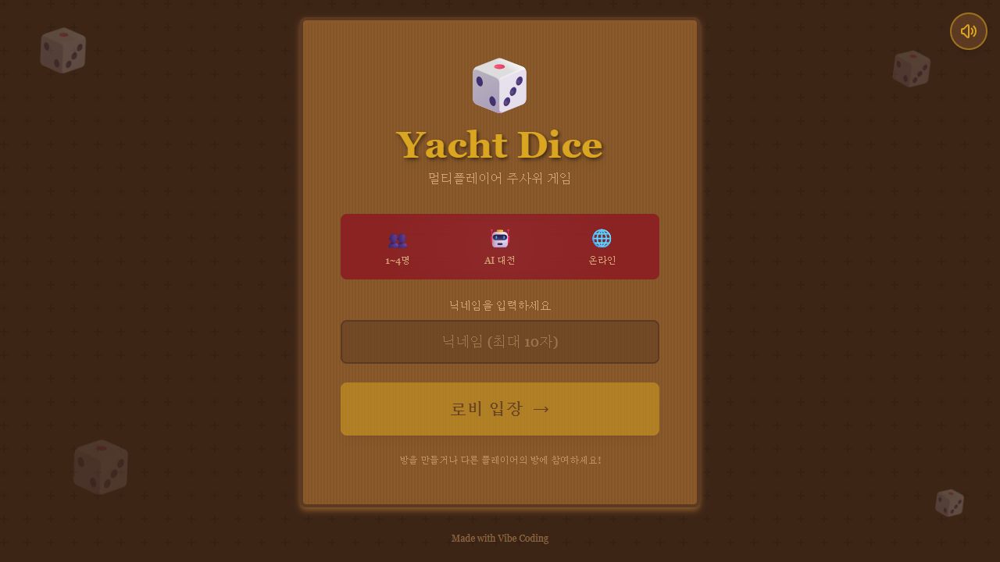

# Yacht Dice

주사위 5개로 족보를 만들어 점수표를 채우는 온라인 야트 다이스 (1~4명, AI 대전, PC · 모바일).

## 플레이

**https://yacht-dice-game.web.app** — 브라우저에서 바로. 닉네임으로 로비 입장 → 방을 만들거나 방 코드로 참가. 방장은 AI 봇(쉬움 · 보통 · 어려움)을 추가할 수 있어 혼자서도 플레이.

## 규칙

- 자기 차례에 주사위를 굴리고, 남길 주사위를 탭해 고정한 뒤 나머지를 다시 굴린다 (턴당 최대 3번)
- 점수표의 빈 칸 하나를 골라 기록. 13칸을 모두 채우면 끝

| 칸 | 점수 |
|---|---|
| Ones ~ Sixes | 해당 눈의 합 |
| 상단 보너스 | Ones~Sixes 합계 63점 이상이면 +35 |
| Three of a Kind | 같은 눈 3개 이상 → 그 눈 × 3 |
| Four of a Kind | 같은 눈 4개 이상 → 그 눈 × 4 |
| Full House | 3개 + 2개 → 주사위 합 |
| Small Straight | 연속 4개 → 그 4개의 합 |
| Large Straight | 연속 5개 → 주사위 합 |
| Choice | 조건 없음 → 주사위 합 |
| Yacht | 5개 모두 같음 → 50 |

빠른 채팅(칭찬 · 도발 · 응원 · 반응 · 인사 · 감정), 배경음악 · 효과음 개별 조절.

## 문의

버그 · 제안은 [Issues](../../issues)에.
